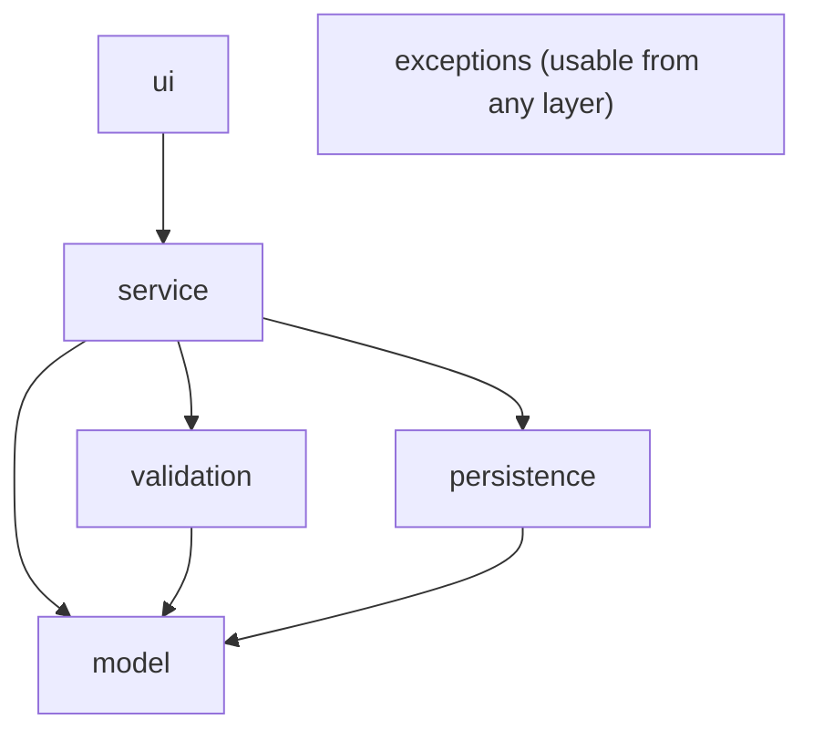

# GameZone Unicesar

A console-based management system for a small video game store, built in Java as the final project for **Programación de Computadores III (SS462)** at Universidad Popular del Cesar.

## What this project does

GameZone Unicesar keeps track of everything a retail video game store needs on a daily basis: which products are in stock, who buys them, who sells them, and what happens after a sale (returns, warranties, promotions). It runs entirely in the terminal and stores all information in plain text files, so records are not lost when the program closes.

The system started as the Taller 1 delivery — products, people and sales — and was later extended with four independent modules, each one documented in its own file under `docs/`.

## System architecture

Every class in the project belongs to one of four layers, plus two supporting packages (`validation` and `exceptions`). Dependencies only flow downwards:

| Layer / package | Contains                                                     |
|-----------------|---------------------------------------------------------------|
| `ui`            | The console menu that reads input and shows output            |
| `service`       | The business rules and coordination between entities          |
| `validation`    | Static validators that check data and throw typed exceptions  |
| `persistence`   | The code that writes to and reads from files                  |
| `model`         | The domain entities (products, sales, people, etc.)           |
| `exceptions`    | The `GameZoneException` hierarchy shared by all layers        |

The rule is enforced strictly: the `model` layer never imports anything from the other layers, the `ui` layer never touches files directly, and validators never access persistence or services.

## Compilation and execution

Requires **JDK 17** or newer and **Maven 3.8** or newer.

To compile:

mvn clean compile

To run the application:

mvn exec:java "-Dexec.mainClass=com.mycompany.gamezone.Main"

## Modules

### Accessories (v1.1.0)

The product catalog was extended with a new line of accessories. An abstract class `Accessory` extends `Product`, and three concrete subclasses represent what the store actually sells: `Controller`, `Cable` and `Memory`. Each accessory keeps a list of the console IDs it is compatible with, so the seller can quickly check compatibility before offering it to a customer.

Accessories are stored separately in `data/accessories.csv` and can be mixed with regular products in a single sale.

New menu option (11 — Accessory management):
1. Register a new controller
2. Register a new cable
3. Register a new memory
4. List all accessories
5. List accessories by type
6. Find accessories compatible with a console

### Promotions (v1.2.0)

Customers respond well to discounts, so the store needed a way to run promotional campaigns with different strategies. Three types of promotions were implemented, all extending the abstract class `Promotion`: percentage-based discounts over the whole sale, category-based discounts limited to video games or consoles, and bulk-purchase discounts that trigger above a minimum item count.

When a sale is registered, the system evaluates every currently active promotion, calculates the discount each one would produce, and applies **only the highest**. Promotions are never stacked. The receipt shows the promotion name and the discount amount whenever one was applied.

Promotions live in `data/promotions.csv`.

New menu option (12 — Promotion management):
1. Register a new percentage discount
2. Register a new category discount
3. Register a new bulk purchase discount
4. List all promotions
5. List active promotions

### Returns (v1.3.0)

Sometimes a customer brings a product back. The return module allows registering partial returns — a customer may return just one item out of several purchased in the same sale — but only within 30 days of the original purchase. Each return validates that the sale exists, that it is still within the return window (`Sale.canBeReturned()`), and that the products being returned actually belong to that sale.

Once accepted, the stock of the returned items is restored automatically and the refund is calculated as the sum of the returned products' prices.

Returns are stored in `data/returns.csv`.

New menu option (13 — Return management):
1. Register a new return
2. View all returns
3. View returns by customer
4. View returns by sale
5. View the monthly balance (total sales minus total returns for a given month)

### Warranties (v1.4.0)

Every console sold at GameZone comes with a free 6-month basic warranty, generated automatically at checkout. Customers can also pay for an extended 12-month warranty that covers accidental damage — this costs 10 % of the product's price and is added to the sale total.

The seller is asked about the extended warranty for each console during the sale registration flow. Warranties are stored in `data/warranties.csv` and can be queried by product, by sale, by active status, or by expiration window.

New menu option (14 — Warranty management):
1. Find the warranty for a product in a specific sale
2. List all warranties
3. List active warranties
4. List warranties expiring within the next 30 days

### Exception handling and validation (Requirement 6)

Failures are reported with a single exception hierarchy rooted at `GameZoneException`, an unchecked exception that carries a stable `errorCode`. Each subclass represents one kind of failure:

| Exception                   | When it is thrown                                    | Message shown by the console menu                                                   |
|-----------------------------|------------------------------------------------------|--------------------------------------------------------------------------------------|
| `ResourceNotFoundException` | A product, person or sale does not exist             | `No se encontró el recurso solicitado: <detail>`                                     |
| `BusinessRuleException`     | A business rule is violated (e.g. not enough stock)  | `No se puede completar la operación: <detail>`                                       |
| `InvalidDataException`      | A field is empty or outside its allowed range        | `Los datos ingresados no son válidos: <detail>`                                      |
| `PersistenceException`      | Reading or writing a data file fails                 | `Ocurrió un problema al acceder a los datos del sistema. Contacte al administrador.` |

The `validation` package contains `ProductValidator`, `PersonValidator` and `SaleValidator`. Their static methods are called by the services, so the rules live in one place instead of being repeated in each service. Repositories wrap `IOException` in `PersistenceException`, and `ConsoleMenu` handles every failure in a single `handleException` method, so the user never sees a stack trace.

Products, people and sales already use the new hierarchy. Accessories, promotions, returns and warranties still throw `IllegalArgumentException`; the console menu keeps handling it until those modules are migrated. No menu option was added or changed: the behaviour of the 14 existing options is the same.

### GRASP audit and correction (Requirement 7)

The code was audited against the nine GRASP patterns and the findings were corrected without changing what the user sees.

- **Phase 1, audit.** Each member audited the code they wrote (`docs/grasp-audit/`). The Technical Lead consolidated the three reports into `docs/grasp-audit/consolidated-audit.md`, with 37 final violations (C-01 to C-37), the member responsible for each one, the boundary findings and the out-of-scope functional defects. The answers to the guiding questions are in `docs/grasp-analysis.md`.
- **Phase 2, correction.** Each violation was corrected by its owner and recorded in `docs/grasp-refactor-log.md`. The main design changes are:
  - `Sale` computes its own total (`applyPromotion`, `addWarrantyCost`) and keeps `SaleItem` objects with the price charged at sale time.
  - `InventoryService` is the single place that routes stock operations between products and accessories.
  - `SaleCatalog` keeps the sales and resolves the raw `SaleRecord` objects loaded by `SaleRepository`, so persistence no longer depends on services. It is also the `SaleLookup` used by `WarrantyService`.
  - `IdGenerator` builds the `SALE-n`, `RETURN-n` and `WAR-n` identifiers.
  - Services own their lists and save them inside each operation; repositories use record mappers and factories (`PersonFactory`, `PromotionFactory`, `WarrantyFactory`) instead of `instanceof` chains.
  - `MonthlyBalanceReport` computes the monthly balance.
  - `ConsoleMenu` only shows the main menu and delegates each option to `ProductMenu`, `PersonMenu`, `SaleMenu`, `AccessoryMenu`, `PromotionMenu`, `ReturnMenu` and `WarrantyMenu`, which share `ConsoleIO`. Texts and option numbers did not change.
- **Non-regression.** `scripts/verify-grasp.sh` runs the same menu script on the build before Phase 2 and on the current build, and compares the console output and the seven data files byte for byte. The before and after class diagrams are in `docs/grasp-class-diagram.md`.

### SOLID audit and correction (Requirement 8)

The code was audited against the five SOLID principles and the findings were corrected without changing what the user sees.

- **Phase 1, audit.** Each member audited the code they wrote (`docs/solid-audit/`). The Technical Lead consolidated the three reports into `docs/solid-audit/consolidated-audit.md`: coverage table, team verdict per principle, 20 final violations (V-01 to V-20) with their owner, the boundary findings and the out-of-scope defects. The answers to the guiding questions are in `docs/solid-analysis.md`.
- **Phase 2, correction.** Each violation was corrected by its owner and recorded in `docs/solid-refactor-log.md`. The main design changes are:
  - **SRP:** receipts and certificates moved out of the model to UI formatters (`SaleReceiptFormatter`, `ReturnReceiptFormatter`, `WarrantyCertificateFormatter`); record mappers separate the line format from file access for sales, returns and warranties; `ReturnCatalog` and `WarrantyCatalog` load and save records so the services keep only the rules.
  - **OCP:** `InventoryService` uses `StockHandler` implementations instead of `instanceof`; `ConsoleIO` maps exceptions to messages; `ConsoleMenu` builds its options as `MenuOption` objects; `ProductService.register(Product)` and `AccessoryService.register(Accessory, ...)` with `AccessoryFactory` accept new types without new methods; `FileProductRepository` receives its converters.
  - **LSP:** `Person.updateFrom` checks the type and delegates to `copyFrom`, so subclasses no longer cast.
  - **ISP:** clients depend on small interfaces (`SaleLookup`, `SaleStore`, `ProductLookup`); `Promotion.isValid()` replaces the percentage-only query.
  - **DIP:** every repository (`SaleRepository`, `ProductRepository`, `AccessoryRepository`, `PromotionRepository`, `ReturnRepository`, `WarrantyRepository`) is an interface with a `File...` implementation built in `Main`.
- **Non-regression.** `scripts/verify-grasp.sh` compared the console output and the seven data files with the build before the requirement: 11/11 identical, and 127 tests pass. The before and after class diagrams are in `docs/solid-class-diagram.md`.

## Project layout

GameZoneUnicesar/
├── README.md
├── TEAM.md
├── CLAUDE.md
├── pom.xml
├── .gitignore
├── LICENSE
├── src/
│ └── main/
│ └── java/
│ └── com/
│ └── mycompany/
│ └── gamezone/
│ ├── exceptions/
│ ├── model/
│ ├── persistence/
│ ├── service/
│ ├── ui/
│ ├── validation/
│ └── Main.java
├── data/
└── docs/
├── analysis.md
├── hierarchy-diagram.md
├── class-diagram.md
├── layers-diagram.md
└── ai-usage/
├── leader-ai-log.md
├── developer1-ai-log.md
└── developer2-ai-log.md

## Documentation

Design documentation lives under `docs/`:

- [Analysis](docs/analysis.md) — initial design of the base system
- [Hierarchy Diagram](docs/hierarchy-diagram.md)
- [Class Diagram](docs/class-diagram.md)
- [Layers Diagram](docs/layers-diagram.md)
- [Accessory Analysis](docs/accessory-analysis.md)
- [Promotion Analysis](docs/promotion-analysis.md)
- [Return Analysis](docs/return-analysis.md)
- [Warranty Analysis](docs/warranty-analysis.md)
- [Exception Class Diagram](docs/exception-class-diagram.md)
- [GRASP Analysis](docs/grasp-analysis.md)
- [GRASP Consolidated Audit](docs/grasp-audit/consolidated-audit.md)
- [GRASP Class Diagram](docs/grasp-class-diagram.md)
- [GRASP Refactor Log](docs/grasp-refactor-log.md)
- [SOLID Analysis](docs/solid-analysis.md)
- [SOLID Consolidated Audit](docs/solid-audit/consolidated-audit.md)
- [SOLID Class Diagram](docs/solid-class-diagram.md)
- [SOLID Refactor Log](docs/solid-refactor-log.md)

## Team

Roles, module ownership, and individual activities are documented in [TEAM.md](TEAM.md).