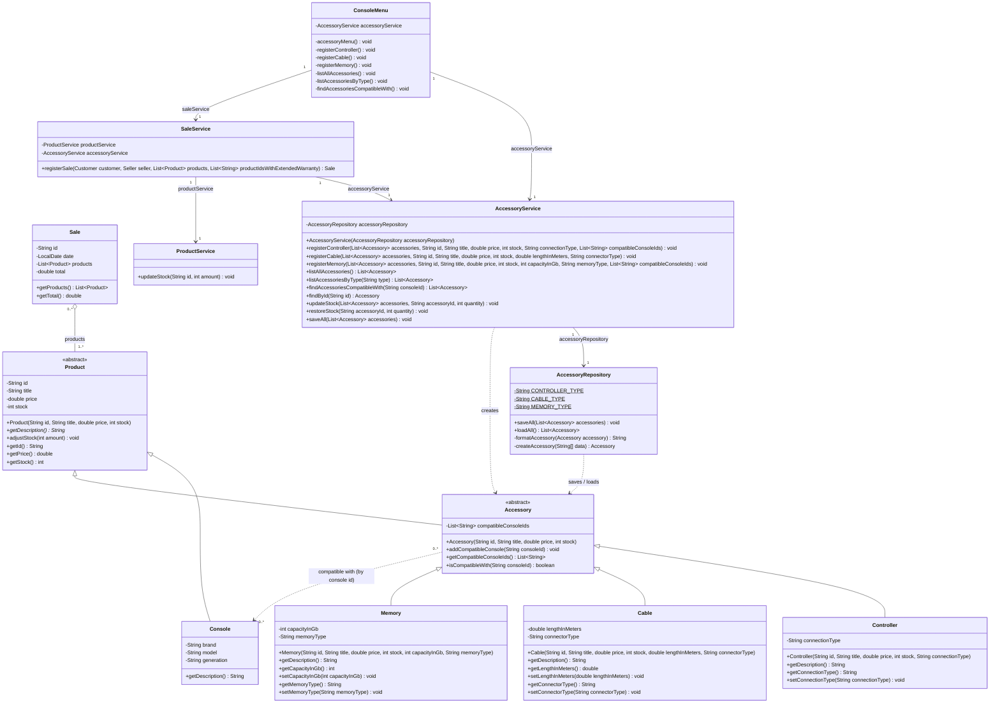

# Accessory Class Diagram — Requirement 1

This diagram shows the accessory module added in Requirement 1 and how it integrates with the existing system. `Accessory` extends `Product`, so accessories reuse the common product attributes and can be sold together with video games and consoles in a single `Sale`.

**Notes**

- Compatibility is stored on the accessory side as a list of console IDs (`compatibleConsoleIds`), persisted in the accessories data file after the type-specific fields.
- `SaleService.registerSale` accepts a single `List<Product>` that may mix products and accessories. Stock is deducted through `AccessoryService.updateStock` for accessories and `ProductService.updateStock` for video games and consoles.
