# Exception Class Diagram

This diagram shows the exception hierarchy added in Requirement 6, the validators that throw them, and the classes that throw or handle them.

```mermaid
classDiagram
    class RuntimeException
    class GameZoneException {
        <<abstract>>
        -String errorCode
        +getErrorCode() String
    }
    class ResourceNotFoundException {
        +ResourceNotFoundException(resourceType, resourceId)
    }
    class BusinessRuleException {
        +BusinessRuleException(message)
    }
    class InvalidDataException {
        +InvalidDataException(fieldName, problem)
    }
    class PersistenceException {
        +PersistenceException(message, cause)
    }

    RuntimeException <|-- GameZoneException
    GameZoneException <|-- ResourceNotFoundException
    GameZoneException <|-- BusinessRuleException
    GameZoneException <|-- InvalidDataException
    GameZoneException <|-- PersistenceException

    class ProductValidator {
        <<static>>
        +validateProductData(id, title, price, stock)
        +validateStockAvailability(product, requestedQuantity)
        +validateProductExists(product, productId)
    }
    class PersonValidator {
        <<static>>
        +validatePersonData(id, name, email, phone)
        +validatePersonExists(person, personId)
        +validateUniquePerson(existing, newId)
    }
    class SaleValidator {
        <<static>>
        +validateSaleData(customer, seller, products)
        +validateSaleExists(sale, saleId)
    }

    ProductValidator ..> InvalidDataException : throws
    ProductValidator ..> BusinessRuleException : throws
    ProductValidator ..> ResourceNotFoundException : throws
    PersonValidator ..> InvalidDataException : throws
    PersonValidator ..> BusinessRuleException : throws
    PersonValidator ..> ResourceNotFoundException : throws
    SaleValidator ..> InvalidDataException : throws
    SaleValidator ..> BusinessRuleException : throws
    SaleValidator ..> ResourceNotFoundException : throws

    class ProductService
    class PersonService
    class SaleService
    class ProductRepository
    class PersonRepository
    class SaleRepository
    class ConsoleMenu {
        -handleException(RuntimeException)
    }

    ProductService ..> ProductValidator : uses
    PersonService ..> PersonValidator : uses
    SaleService ..> SaleValidator : uses
    SaleService ..> ProductValidator : uses
    ProductRepository ..> PersistenceException : throws
    PersonRepository ..> PersistenceException : throws
    SaleRepository ..> PersistenceException : throws
    ConsoleMenu ..> GameZoneException : catches
```

## Notes

- `GameZoneException` is unchecked, so services and the console menu do not need `throws` clauses.
- Only products, people and sales use the new hierarchy. Accessories, promotions, returns and warranties still throw `IllegalArgumentException`, which `ConsoleMenu` keeps handling until they are migrated.