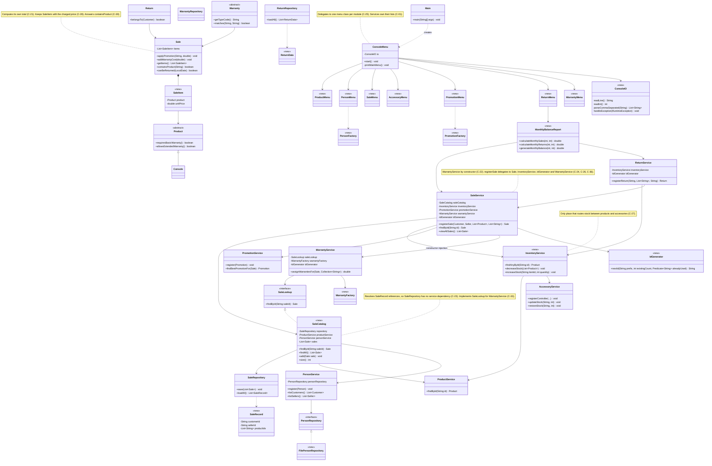

# GRASP Class Diagram

Class diagrams of the system before and after the GRASP corrections of Requirement 7, Phase 2. Each marked element references the final violation (`C-xx`) in `docs/grasp-audit/consolidated-audit.md`.

## Before

State of `develop` at commit `8382d85`, before any correction. Only the classes and members involved in the final violations are shown.

```mermaid
classDiagram
direction TB

    %% ========== UI ==========
    class Main {
        +main(String[] args) void
    }

    class ConsoleMenu {
        -Scanner scanner
        -ProductService productService
        -PersonService personService
        -SaleService saleService
        -AccessoryService accessoryService
        -PromotionService promotionService
        -ReturnService returnService
        -WarrantyService warrantyService
        -ArrayList~Person~ persons
        +start() void
        -getCustomers() List~Customer~
        -getSellers() List~Seller~
    }

    %% ========== SERVICE ==========
    class SaleService {
        -SaleRepository repository
        -List~Sale~ sales
        -ProductService productService
        -AccessoryService accessoryService
        -PromotionService promotionService
        -WarrantyService warrantyService
        +setWarrantyService(WarrantyService) void
        +registerSale(Customer, Seller, List~Product~, ...) Sale
        +findById(String id) Sale
        +viewAllSales() List~Sale~
    }

    class ProductService {
        -ProductRepository productRepository
        -List~Product~ products
        +findById(String id) Product
        +restoreStock(String id, int quantity) void
    }

    class AccessoryService {
        -AccessoryRepository accessoryRepository
        +registerController(List~Accessory~, ...) void
        +listAccessoriesByType(String) List~Accessory~
        +updateStock(List~Accessory~, String, int) void
        +restoreStock(String, int) void
        +saveAll(List~Accessory~) void
    }

    class PersonService {
        -PersonRepository personRepository
        +registerCustomer(ArrayList~Person~, ...) void
        +registerSeller(ArrayList~Person~, ...) void
        +searchPerson(...) Person
        +savePersons(ArrayList~Person~) void
    }

    class PromotionService {
        -PromotionRepository promotionRepository
        +registerPercentageDiscount(...) void
        +registerCategoryDiscount(...) void
        +registerBulkPurchaseDiscount(...) void
        +findBestPromotionFor(Sale) Promotion
        +saveAll(List~Promotion~) void
    }

    class ReturnService {
        -ReturnRepository repository
        -SaleService saleService
        -ProductService productService
        -AccessoryService accessoryService
        -WarrantyService warrantyService
        -List~Return~ returns
        -findItemById(String) Product
        -restoreItemStock(Product) void
        -generateReturnId() String
        +calculateMonthlySales(int month, int year) double
        +generateMonthlyBalance(int month, int year) double
    }

    class WarrantyService {
        -WarrantyRepository repository
        -SaleRepository saleRepository
        -ProductService productService
        -List~Warranty~ warranties
        +assignExtendedWarranty(Product, Sale) Warranty
        -generateWarrantyId() String
    }

    %% ========== PERSISTENCE ==========
    class SaleRepository {
        -ProductService productService
        -PersonService personService
        +save(List~Sale~) void
        +load() List~Sale~
        +findById(String id) Sale
        -findCustomerById(String) Customer
        -findSellerById(String) Seller
    }

    class ReturnRepository {
        -String filePath
        -SaleService saleService
        -ProductService productService
        -AccessoryService accessoryService
    }

    class WarrantyRepository {
        -String filePath
    }
    class PersonRepository {
        -createPerson(String[]) Person
    }
    class ProductRepository {
        -toLine(Product) String
        -toProduct(String line) Product
    }
    class AccessoryRepository {
        -formatAccessory(Accessory) String
        -createAccessory(String[]) Accessory
    }
    class PromotionRepository {
        -formatPromotion(Promotion) String
        -createPromotion(String[]) Promotion
    }

    %% ========== MODEL ==========
    class Sale {
        -String id
        -LocalDate date
        -Seller seller
        -Customer customer
        -List~Product~ products
        -double total
        -double discountAmount
        -double warrantyCost
        +setTotal(double total) void
        +getSubtotal() double
        +canBeReturned() boolean
    }

    class Product {
        <<abstract>>
        -String id
        -String title
        -double price
        -int stock
        +adjustStock(int) void
    }
    class Console
    class Accessory {
        <<abstract>>
    }
    class Return {
        -Sale originalSale
        -List~Product~ returnedProducts
        +calculateRefundAmount() double
    }
    class Warranty {
        <<abstract>>
        -Product product
        -Sale sale
    }
    class Customer {
        -ArrayList~Sale~ purchases
    }
    class Seller {
        -ArrayList~Sale~ sales
    }

    Product <|-- Console
    Product <|-- Accessory

    %% ========== DEPENDENCIES ==========
    Main ..> ConsoleMenu : creates
    Main ..> SaleService : creates
    ConsoleMenu --> ProductService
    ConsoleMenu --> PersonService
    ConsoleMenu --> SaleService
    ConsoleMenu --> AccessoryService
    ConsoleMenu --> PromotionService
    ConsoleMenu --> ReturnService
    ConsoleMenu --> WarrantyService

    SaleService --> SaleRepository
    SaleService --> ProductService : stock if not Accessory (C-27)
    SaleService --> AccessoryService : stock if Accessory (C-27)
    SaleService --> PromotionService
    SaleService --> WarrantyService : setter, may be null (C-22)
    SaleService ..> Sale : setTotal from outside (C-21)

    ReturnService --> ReturnRepository
    ReturnService --> SaleService
    ReturnService --> ProductService : stock if not Accessory (C-27)
    ReturnService --> AccessoryService : stock if Accessory (C-27)
    ReturnService --> WarrantyService

    WarrantyService --> WarrantyRepository
    WarrantyService --> SaleRepository : skips SaleService (C-33)
    WarrantyService --> ProductService

    PersonService ..> PersonRepository : new inside class (C-03, C-08)
    ProductService --> ProductRepository
    AccessoryService --> AccessoryRepository
    PromotionService --> PromotionRepository

    SaleRepository --> ProductService : persistence to service (C-23)
    SaleRepository --> PersonService : persistence to service (C-23)
    ReturnRepository --> SaleService : persistence to service (C-29)
    ReturnRepository --> ProductService : persistence to service (C-29)
    ReturnRepository --> AccessoryService : persistence to service (C-29)

    Sale --> Product : live price (C-28)
    Return --> Sale
    Warranty --> Sale
    Warranty --> Product

    note for SaleService "registerSale does id, promotion, warranties, stock and saving (C-24). instanceof Console (C-26). instanceof Accessory (C-27). Sale id built inline (C-36)."
    note for ConsoleMenu "Loads the lists of persons, accessories and promotions, passes them to the services and calls save (C-01). 989 lines, keeps the persons list, filters customers and sellers (C-25). instanceof Console (C-26)."
    note for Sale "Total computed by SaleService via setTotal. warrantyCost never set (C-21)."
```

### Violations shown in the "Before" diagram

| Element in the diagram | Violation | Pattern |
|---|---|---|
| `ConsoleMenu` loads, passes and saves the lists of other modules | C-01 | Controller |
| `PersonService` creates its own `PersonRepository` | C-03, C-08 | Low Coupling, Protected Variations |
| `Customer.purchases`, `Seller.sales` never used | C-04 | Low Coupling |
| `instanceof` / type strings in the repositories | C-05, C-10, C-13, C-17, C-34 | Polymorphism |
| `SaleService` sets the total of `Sale` | C-21 | Information Expert |
| `SaleService.setWarrantyService`, may be `null` | C-22 | Low Coupling |
| `SaleRepository` depends on `ProductService` and `PersonService` | C-23 | Low Coupling |
| `SaleService.registerSale` does too many things | C-24 | High Cohesion |
| `ConsoleMenu` too large, keeps `persons` | C-25 | High Cohesion |
| `instanceof Console` in `SaleService`, `ConsoleMenu`, `ReturnService` | C-26 | Polymorphism |
| `instanceof Accessory` stock routing in `SaleService` and `ReturnService` | C-27 | Indirection |
| `Sale` keeps a list of `Product` and reads the live price | C-28 | Protected Variations |
| `ReturnRepository` depends on services | C-29 | Low Coupling |
| `WarrantyService` uses `SaleRepository` directly | C-33 | Low Coupling |
| Ids generated inline in three services | C-36 | Pure Fabrication |

The other final violations (C-02, C-06, C-07, C-09, C-11, C-12, C-14 to C-20, C-30 to C-32, C-35, C-37) live inside a single class and do not change the dependencies, so they are only listed in the consolidated audit.

## After

State of `feature/grasp-refactor` with every correction of the consolidated audit applied. Only the classes and members involved in the final violations are shown. New classes are marked with `<<new>>`.

### Violations resolved in the "After" diagram

| Element in the diagram | Violation | Pattern |
|---|---|---|
| Services own and save their lists; menus only forward input | C-01 | Controller |
| `PersonService(PersonRepository)` wired in `Main`; `FilePersonRepository` behind the `PersonRepository` interface | C-03, C-08 | Low Coupling, Protected Variations |
| Record mappers and factories instead of `instanceof` chains | C-05, C-10, C-13, C-17, C-34 | Polymorphism |
| `Sale.applyPromotion` and `Sale.addWarrantyCost` | C-21 | Information Expert |
| `WarrantyService` injected through the `SaleService` constructor | C-22 | Low Coupling |
| `SaleRepository` returns `SaleRecord`; `SaleCatalog` resolves references | C-23 | Low Coupling |
| `registerSale` delegates every step | C-24 | High Cohesion |
| `ConsoleMenu` split into seven menu classes and `ConsoleIO` | C-25 | High Cohesion |
| `Product.requiresBasicWarranty` / `allowsExtendedWarranty` | C-26 | Polymorphism |
| `InventoryService` | C-27 | Indirection |
| `SaleItem` | C-28 | Protected Variations |
| `ReturnData`; `ReturnRepository` without services | C-29 | Low Coupling |
| `Sale.containsProduct` and `Return.belongsTo` | C-30 | Information Expert |
| `MonthlyBalanceReport` | C-31 | High Cohesion |
| `WarrantyService` depends on `SaleLookup`, implemented by `SaleCatalog` | C-33 | Low Coupling |
| `IdGenerator` | C-36 | Pure Fabrication |

**Design decision on C-22 and C-33.** The consolidated audit asked for `SaleLookup` to be implemented by `SaleService`, but C-22 makes `SaleService` receive `WarrantyService` in its constructor, and `WarrantyService` needs a `SaleLookup` in its own constructor, which is a creation cycle. The list of sales was moved to the new class `SaleCatalog`, which implements `SaleLookup`. `Main` creates `SaleCatalog`, then `WarrantyService`, then `SaleService`, with no cycle and no setter.
