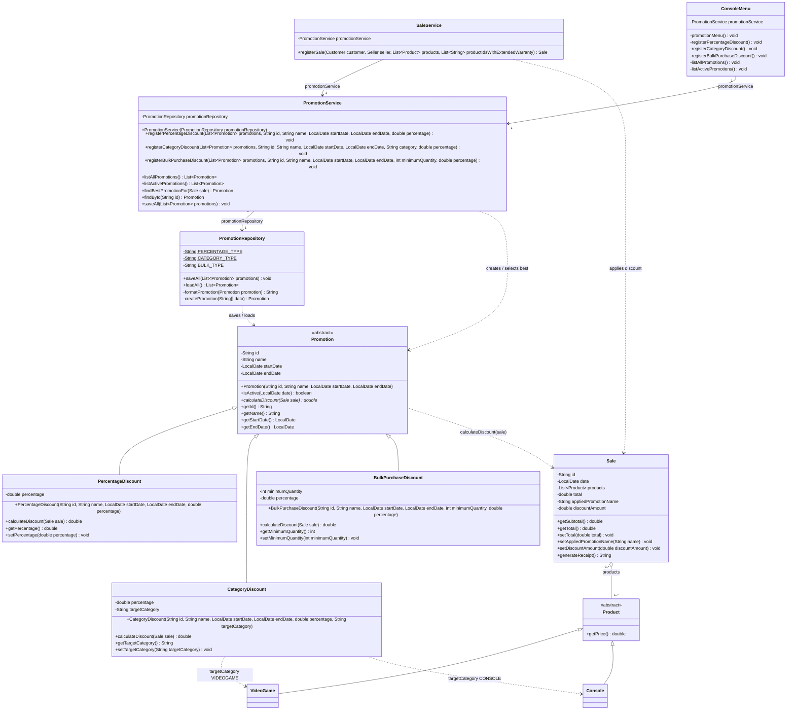

# Promotion Class Diagram — Requirement 2

This diagram shows the promotion hierarchy added in Requirement 2, its persistence and service classes, and how the best promotion is applied when `SaleService` registers a sale.

**Notes**

- `Sale` keeps only the name of the applied promotion and the discount amount (two additive attributes), not a reference to the `Promotion` object.
- `PromotionService.findBestPromotionFor` evaluates every active promotion and returns the one with the highest discount, or `null` when none gives a discount greater than zero. `SaleService.registerSale` then sets `appliedPromotionName`, `discountAmount` and the final total.
- `CategoryDiscount` also accepts the `ACCESSORY` category in the current code, in addition to `VIDEOGAME` and `CONSOLE`.
