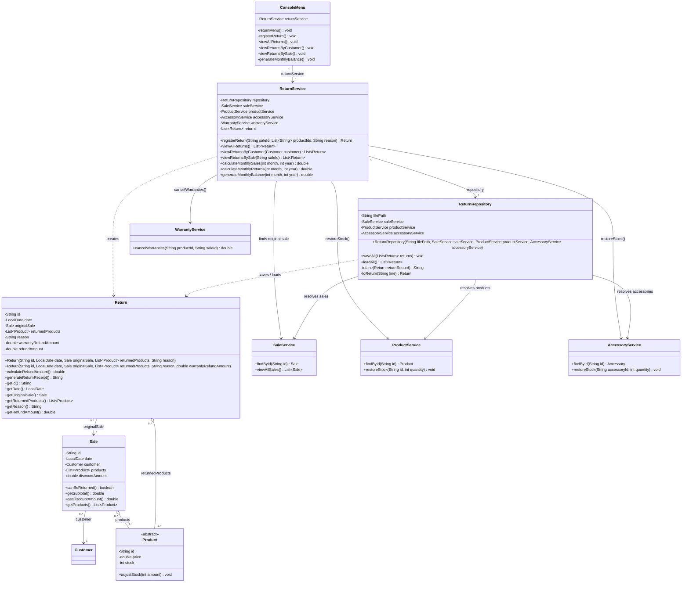

# Return Class Diagram — Requirement 3

This diagram shows the `Return` entity added in Requirement 3, its persistence and service classes, and its integration with `Sale`, `ProductService` and the console menu.

**Notes**

- `Return` is associated with exactly one original `Sale` and keeps only the products that were returned, which may be a subset of the sale's products.
- `ProductService.restoreStock` (added by the Technical Lead) is the existing stock operation reused from the return flow, and `AccessoryService.restoreStock` covers returned accessories.
- The monthly balance (`generateMonthlyBalance`) lives in `ReturnService` because it combines sales (through `SaleService`) and returns.
