# SOLID Class Diagram - Before and After

Classes involved in the violations of `docs/solid-audit/consolidated-audit.md`. Notes show the violation IDs.

## Before (start of Phase 2, develop `d2d7245`)

```mermaid
classDiagram
    class Sale {
        -List~SaleItem~ items
        -double total
        +calculateTotal() double
        +applyPromotion(Promotion)
        +addWarrantyCost(double)
        +generateReceipt() String
    }
    note for Sale "V-01 receipt text inside the model"
    class SaleRepository {
        +save(List~Sale~)
        +loadAll() List~SaleRecord~
        -toLine(Sale) String
        -parseRecord(String) SaleRecord
    }
    note for SaleRepository "V-02 format + file, V-17 concrete"
    class SaleCatalog {
        -SaleRepository repository
        +findAll() List~Sale~
        +findById(String) Sale
        +add(Sale)
    }
    class SaleService {
        -SaleCatalog catalog
        +registerSale(...)
        +viewAllSales() List~Sale~
        +findById(String) Sale
    }
    note for SaleService "V-18 depends on concrete SaleCatalog"
    class InventoryService {
        -ProductService productService
        -AccessoryService accessoryService
        +findAnyById(String) Product
        +decreaseStock(Product, int)
        +increaseStock(Product, int)
    }
    note for InventoryService "V-08 instanceof routing"
    class ConsoleIO {
        +handleException(Exception)
    }
    note for ConsoleIO "V-09 if chain"
    class ConsoleMenu {
        +start()
        -printMainMenu()
    }
    note for ConsoleMenu "V-10 switch"
    class ReturnMenu
    note for ReturnMenu "V-16 uses whole SaleService"
    class Return {
        +calculateRefundAmount() double
        +generateReturnReceipt() String
    }
    note for Return "V-03"
    class Warranty {
        <<abstract>>
        +generateWarrantyCertificate() String
    }
    note for Warranty "V-04"
    class ProductService {
        -ProductRepository repository
        +registerVideoGame(...)
        +registerConsole(...)
        +findById(String) Product
    }
    note for ProductService "V-11, V-19"
    class ProductRepository {
        -List~ProductLineConverter~ converters
        +saveAll(List~Product~)
        +loadAll() List~Product~
    }
    note for ProductRepository "V-12 fixed converters"
    class Promotion {
        <<abstract>>
        +calculateDiscount(Sale) double
        +hasValidPercentage() boolean
    }
    note for Promotion "V-15"
    class ReturnService {
        -ReturnRepository repository
        -SaleService saleService
        +registerReturn(...)
        -loadReturns()
    }
    note for ReturnService "V-05, V-16, V-20"
    class WarrantyService {
        -WarrantyRepository repository
        -ProductService productService
        -warranties()
        -loadWarranties()
        +assignWarrantiesFor(...)
    }
    note for WarrantyService "V-06, V-16, V-20"
    class ReturnRepository {
        +saveAll()
        +loadAll()
        -toLine()
    }
    class WarrantyRepository {
        +saveAll()
        +loadAll()
        -toLine()
    }
    note for ReturnRepository "V-07"
    class AccessoryService {
        -AccessoryRepository accessoryRepository
        +registerController(...)
        +registerCable(...)
        +registerMemory(...)
    }
    note for AccessoryService "V-13, V-20"
    class PromotionService {
        -PromotionRepository promotionRepository
    }
    class MonthlyBalanceReport {
        -SaleService saleService
    }
    note for MonthlyBalanceReport "V-16"
    class Person {
        <<abstract>>
        +updateFrom(Person)
    }
    class Customer
    class Seller
    note for Customer "V-14 cast in updateFrom"

    SaleCatalog --> SaleRepository
    SaleService --> SaleCatalog
    ReturnMenu --> SaleService
    ReturnService --> SaleService
    ReturnService --> ReturnRepository
    WarrantyService --> WarrantyRepository
    WarrantyService --> ProductService
    MonthlyBalanceReport --> SaleService
    ProductService --> ProductRepository
    InventoryService --> ProductService
    InventoryService --> AccessoryService
    Person <|-- Customer
    Person <|-- Seller
```

## After (end of Phase 2)

```mermaid
classDiagram
    class Sale {
        +calculateTotal() double
        +applyPromotion(Promotion)
        +addWarrantyCost(double)
    }
    class SaleReceiptFormatter {
        +format(Sale) String
    }
    note for SaleReceiptFormatter "V-01"
    class SaleRepository {
        <<interface>>
        +save(List~Sale~)
        +loadAll() List~SaleRecord~
    }
    class FileSaleRepository
    class SaleRecordMapper {
        +toLine(Sale) String
        +toRecord(String[]) SaleRecord
    }
    note for SaleRecordMapper "V-02, V-17"
    class SaleLookup {
        <<interface>>
        +findById(String) Sale
    }
    class SaleStore {
        <<interface>>
        +findAll() List~Sale~
        +add(Sale)
        +size() int
    }
    note for SaleStore "V-16, V-18"
    class SaleCatalog
    class SaleService
    class StockHandler {
        <<interface>>
        +findById(String) Product
        +handles(Product) boolean
        +decrease(Product, int)
        +restore(Product, int)
    }
    class ProductStockHandler
    class AccessoryStockHandler
    class InventoryService {
        -List~StockHandler~ handlers
    }
    note for StockHandler "V-08"
    class ConsoleIO {
        -Map messages
        +handleException(Exception)
    }
    note for ConsoleIO "V-09"
    class MenuOption {
        +number int
        +label String
        +action Runnable
    }
    class ConsoleMenu {
        -List~MenuOption~ options
    }
    note for MenuOption "V-10"
    class ReturnMenu
    class Return {
        +calculateRefundAmount() double
        +listPriceOf(Product) double
        +proportionalDiscountOf(Product) double
    }
    class ReturnReceiptFormatter {
        +format(Return) String
    }
    note for ReturnReceiptFormatter "V-03"
    class Warranty {
        <<abstract>>
    }
    class WarrantyCertificateFormatter {
        +format(Warranty) String
    }
    note for WarrantyCertificateFormatter "V-04"
    class Product {
        <<abstract>>
        +validateDetails()
    }
    class ProductLookup {
        <<interface>>
        +findById(String) Product
    }
    class ProductService {
        +register(Product)
    }
    note for ProductService "V-11, V-16, V-19"
    class ProductRepository {
        <<interface>>
        +saveAll(List~Product~)
        +loadAll() List~Product~
    }
    class FileProductRepository {
        +FileProductRepository(String, List~ProductLineConverter~)
    }
    note for FileProductRepository "V-12"
    class Promotion {
        <<abstract>>
        +isValid() boolean
    }
    note for Promotion "V-15"
    class PromotionValidator
    class ReturnCatalog {
        +findAll() List~Return~
        +add(Return)
        +containsId(String) boolean
    }
    note for ReturnCatalog "V-05"
    class ReturnService
    class WarrantyCatalog {
        +findAll() List~Warranty~
        +findById(String) Warranty
        +add(Warranty)
        +removeAll(List~Warranty~)
    }
    note for WarrantyCatalog "V-06"
    class WarrantyService
    class ReturnRepository {
        <<interface>>
    }
    class FileReturnRepository
    class ReturnRecordMapper
    class WarrantyRepository {
        <<interface>>
    }
    class FileWarrantyRepository
    class WarrantyRecordMapper
    class WarrantyData
    note for ReturnRecordMapper "V-07"
    class AccessoryRepository {
        <<interface>>
    }
    class FileAccessoryRepository
    class PromotionRepository {
        <<interface>>
    }
    class FilePromotionRepository
    note for AccessoryRepository "V-20"
    class AccessoryFactory {
        +createController(...) Accessory
        +createCable(...) Accessory
        +createMemory(...) Accessory
    }
    class AccessoryService {
        +register(Accessory, List~String~)
    }
    note for AccessoryFactory "V-13"
    class MonthlyBalanceReport
    class Person {
        <<abstract>>
        +updateFrom(Person)
        #copyFrom(Person)
    }
    class Customer
    class Seller
    note for Person "V-14"

    SaleReceiptFormatter ..> Sale
    SaleRepository <|.. FileSaleRepository
    FileSaleRepository --> SaleRecordMapper
    SaleLookup <|-- SaleStore
    SaleStore <|.. SaleCatalog
    SaleCatalog --> SaleRepository
    SaleService --> SaleStore
    StockHandler <|.. ProductStockHandler
    StockHandler <|.. AccessoryStockHandler
    InventoryService --> StockHandler
    ConsoleMenu --> MenuOption
    ReturnMenu --> SaleLookup
    ReturnMenu --> ReturnReceiptFormatter
    ReturnReceiptFormatter ..> Return
    WarrantyCertificateFormatter ..> Warranty
    ProductLookup <|.. ProductService
    ProductService --> ProductRepository
    ProductRepository <|.. FileProductRepository
    PromotionValidator ..> Promotion
    ReturnService --> ReturnCatalog
    ReturnService --> SaleLookup
    ReturnCatalog --> ReturnRepository
    ReturnRepository <|.. FileReturnRepository
    FileReturnRepository --> ReturnRecordMapper
    WarrantyService --> WarrantyCatalog
    WarrantyCatalog --> WarrantyRepository
    WarrantyCatalog --> ProductLookup
    WarrantyCatalog --> SaleLookup
    WarrantyRepository <|.. FileWarrantyRepository
    FileWarrantyRepository --> WarrantyRecordMapper
    WarrantyRecordMapper ..> WarrantyData
    AccessoryRepository <|.. FileAccessoryRepository
    PromotionRepository <|.. FilePromotionRepository
    AccessoryService --> AccessoryRepository
    AccessoryService --> AccessoryFactory
    MonthlyBalanceReport --> SaleStore
    Person <|-- Customer
    Person <|-- Seller
```

Removed: `Sale.generateReceipt` and `append*`, `Return.generateReturnReceipt`, `Warranty.generateWarrantyCertificate`, `Promotion.hasValidPercentage`, the `switch` in `ConsoleMenu`, the `instanceof` chain in `InventoryService` and the if-chain in `ConsoleIO`. `SaleRepository`, `ProductRepository`, `AccessoryRepository`, `PromotionRepository`, `ReturnRepository` and `WarrantyRepository` changed from concrete classes to interfaces.
