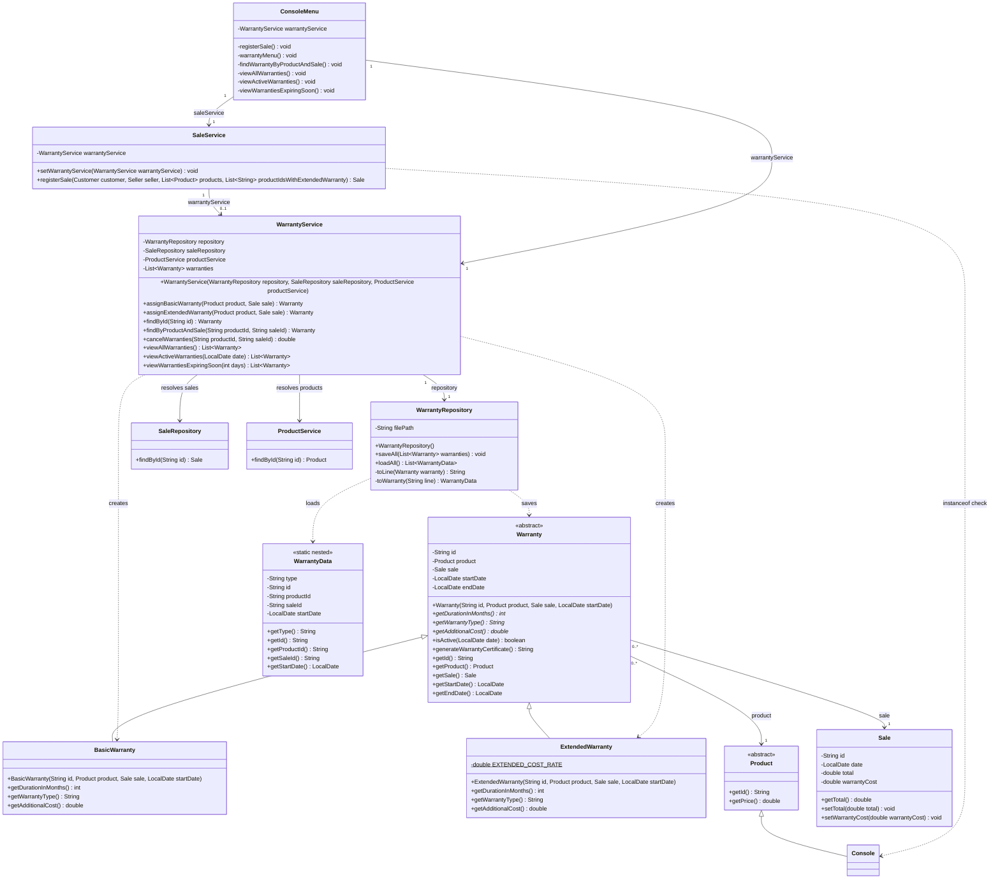

# Warranty Class Diagram — Requirement 4

This diagram shows the warranty hierarchy added in Requirement 4, its persistence and service classes, and how `SaleService` assigns warranties when a sale is registered.

**Notes**

- The end date is calculated once in the `Warranty` constructor as `startDate.plusMonths(getDurationInMonths())`, so each subclass only states its duration (6 or 12 months).
- During `SaleService.registerSale`, every `Console` gets a `BasicWarranty`. Each product whose ID is in `productIdsWithExtendedWarranty` also gets an `ExtendedWarranty`, and its `getAdditionalCost()` (10% of the price) is added to the sale total.
- `WarrantyService` is injected into `SaleService` with a setter after construction to avoid a circular dependency at startup.
